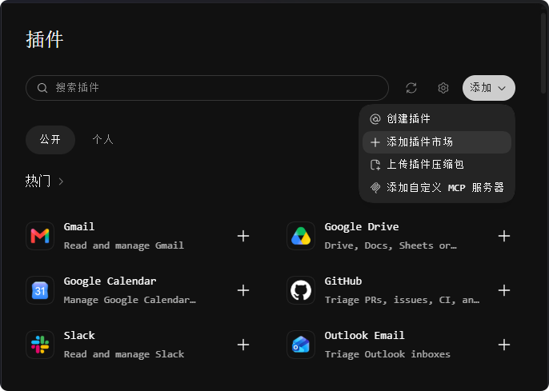
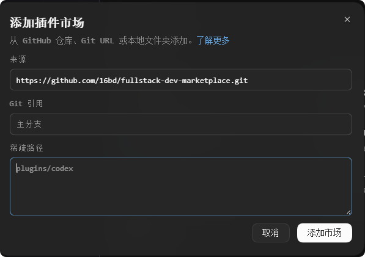
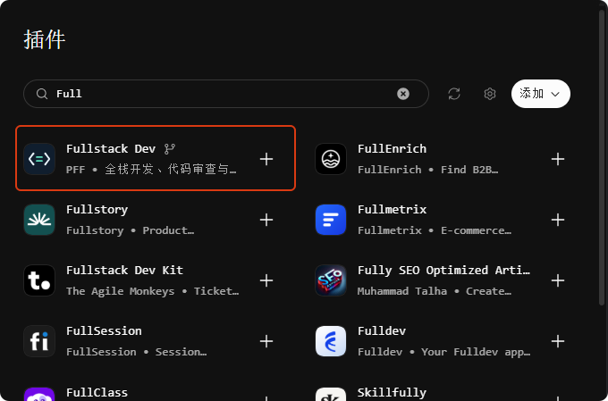
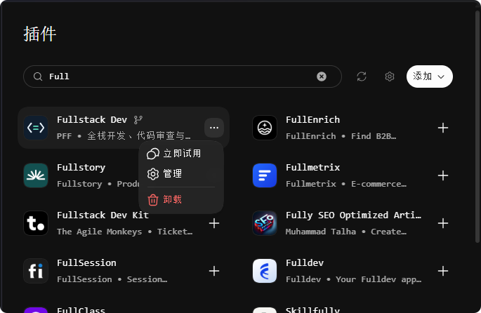

# Fullstack Dev

用于前端、后端、联调和脚本开发，也支持代码审查、仓库审计和技术债盘点。

## 在 Codex Desktop 安装

### 1. 打开「添加插件市场」

在 Codex Desktop 左侧打开 **插件**。点击插件页右上角的 **添加**，再选 **添加插件市场**。



### 2. 填写 GitHub 仓库地址

复制下面的地址，粘贴到 **来源**。**Git 引用**和**稀疏路径**都留空，然后点击右下角的 **添加市场**。

```text
https://github.com/16bd/fullstack-dev-marketplace.git
```



### 3. 搜索并安装 Fullstack Dev

回到插件页，在搜索框输入 **Fullstack Dev**。找到发布人为 **PFF** 的结果，点击右侧的 **＋**。如果列表里还没有这条结果，点击搜索框右侧的刷新图标再搜一次。



### 4. 开始使用

安装完成后，插件右侧的 **＋** 会变成 **⋯**。点击 **⋯ → 立即试用**，然后输入你要做的事。也可以新建一个 Codex 对话，直接输入需求。

> 给订单列表加状态筛选，并验证分页和清空筛选的行为。



## 在终端安装

```powershell
codex plugin marketplace add https://github.com/16bd/fullstack-dev-marketplace.git
codex plugin add fullstack-dev@fullstack-dev-marketplace
```

## 更新

```powershell
codex plugin marketplace upgrade fullstack-dev-marketplace
```

维护者将本目录的内容提交到 Git 仓库根目录，确保隐藏目录 `.agents/` 也已提交。更新插件时递增 `plugins/fullstack-dev/plugin.json` 中的版本号。
