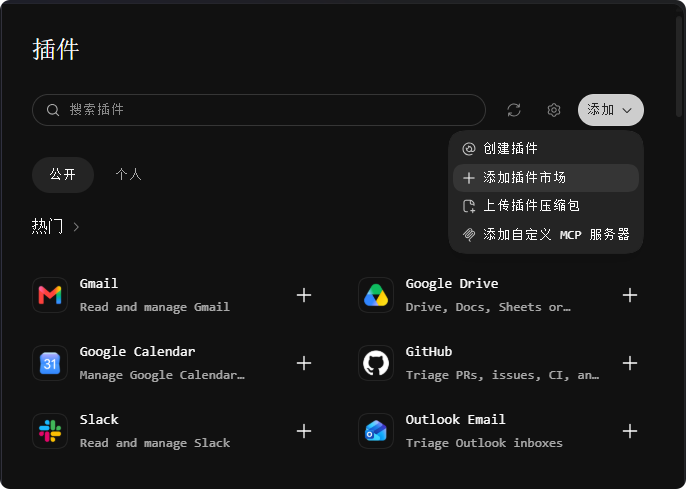
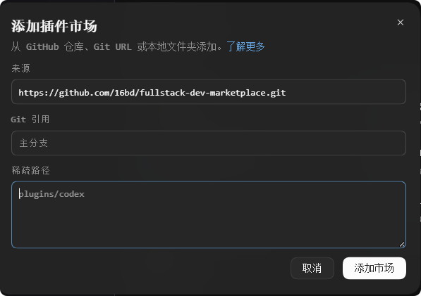
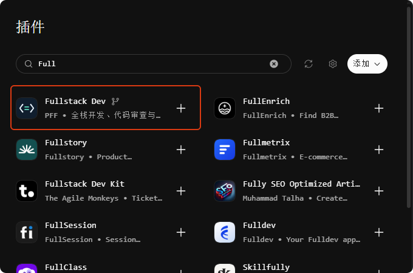
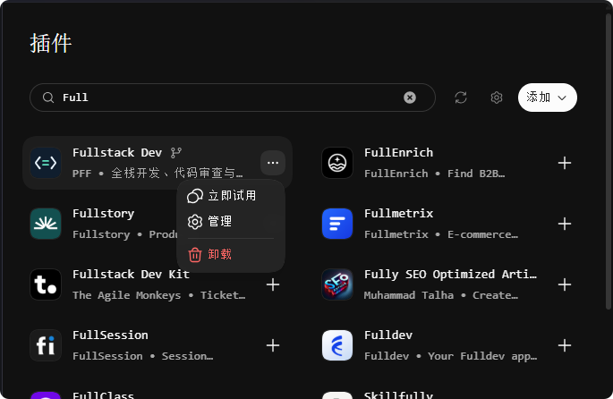

# Codex Desktop 怎么安装 GitHub 第三方插件？以 Fullstack Dev 为例

在 Codex Desktop 左侧打开 **插件**，点击右上角的 **添加 → 添加插件市场**，把 GitHub 仓库地址粘贴到 **来源**。添加市场后，在插件页搜索插件名并安装。以 Fullstack Dev 为例，来源填写 `https://github.com/16bd/fullstack-dev-marketplace.git`，**Git 引用**和**稀疏路径**都留空。

## 1. 打开「添加插件市场」

在 Codex Desktop 左侧打开 **插件**，点击插件页右上角的 **添加**，再选 **添加插件市场**。



## 2. 把 GitHub 仓库地址填到「来源」

在弹窗的 **来源** 字段粘贴下面的地址，再点击右下角的 **添加市场**。

```text
https://github.com/16bd/fullstack-dev-marketplace.git
```

**Git 引用**用于指定分支、标签或提交。留空会使用仓库的默认分支。**稀疏路径**用于只拉取仓库中的指定路径。Fullstack Dev 的市场清单和插件都在这个仓库里，留空即可。安装其他插件时，按发布者给出的市场地址和参数填写。 [OpenAI 插件市场文档](https://developers.openai.com/plugins/build/plugins#add-a-marketplace-from-the-cli)



## 3. 搜索 Fullstack Dev，认准发布人 PFF

回到插件页，在搜索框输入 **Fullstack Dev**。找到发布人为 **PFF** 的条目，点击右侧的 **＋** 安装。如果没看到结果，先确认市场已添加，再点搜索框右侧的刷新图标重新搜索。



## 4. 选「立即试用」，发出第一条开发需求

安装后，条目右侧的 **＋** 会变成 **⋯**。点击 **⋯ → 立即试用**，或新建 Codex 对话，直接输入需求。Fullstack Dev 支持中文代码审查、前后端联调和脚本开发，可以从下面任选一条试用。

- 给订单列表加状态筛选，并验证分页和清空筛选的行为。
- 排查订单 API 返回空列表的问题，核对前端传参和分页行为。
- 审查当前 PR，按严重程度列出有代码证据的缺陷和回归风险。



终端安装命令和后续更新方法见 [Fullstack Dev GitHub 安装指南](https://github.com/16bd/fullstack-dev-marketplace#readme)。
